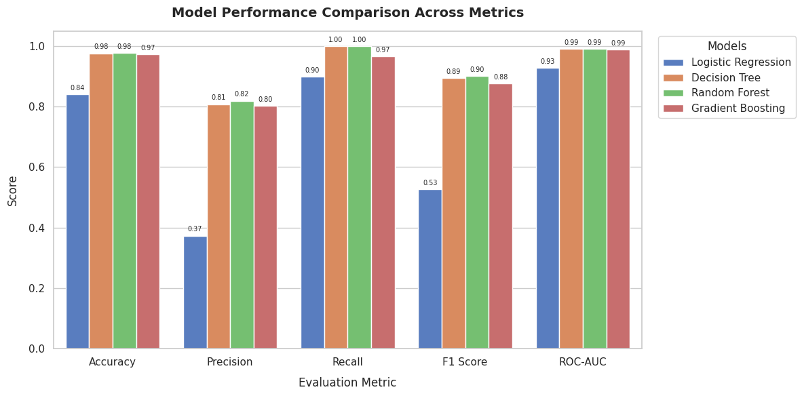
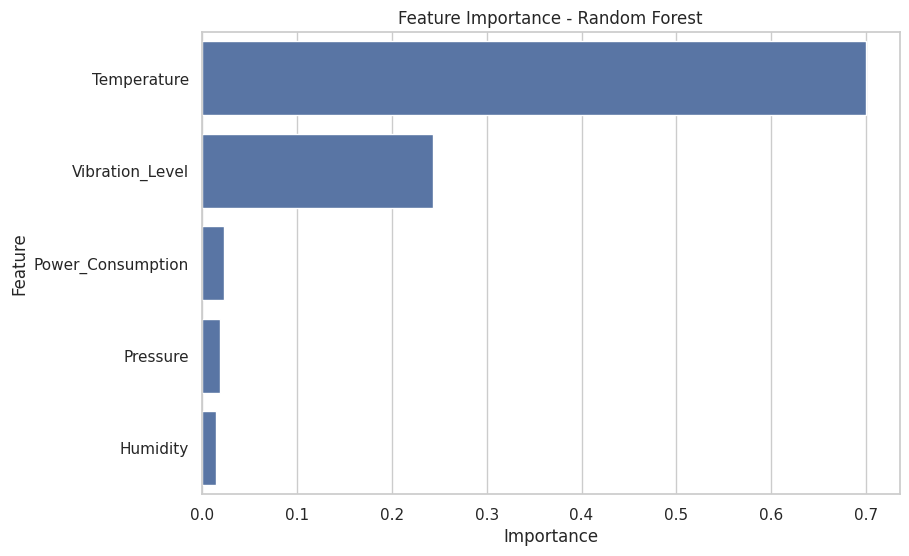

# Predictive Maintenance & Machine Failure Prediction

An end-to-end Machine Learning pipeline designed to predict industrial machine failures using sensor data, exploratory data analysis, and advanced classification algorithms.

---

## 📋 Table of Contents
- [Project Overview](#-project-overview)
- [Project Workflow](#-project-workflow)
- [Dataset & Features](#-dataset--features)
- [Exploratory Data Analysis (EDA)](#-exploratory-data-analysis-eda)
- [Model Training & Evaluation](#-model-training--evaluation)
- [Results & Feature Importance](#-results--feature-importance)
- [Installation & Usage](#-installation--usage)
- [License](#-license)

---

## 🔍 Project Overview
Predictive maintenance helps industries anticipate equipment failures before they happen, reducing costly downtime and repairs. This project builds a robust predictive model using sensor metrics to classify whether a machine will fail or operate normally.

---

## 🛠️ Project Workflow
The notebook is structured into the following sequential steps[cite: 1, 2]:
1. **Data Ingestion & Inspection:** Loading the dataset, verifying column names, checking data types, summary statistics, and handling missing values or duplicates[cite: 1].
2. **Exploratory Data Analysis (EDA):** Analyzing target and feature distributions, running correlation matrices, and comparing sensor averages[cite: 1].
3. **Data Preprocessing:** Splitting data into train/test sets and applying **SMOTE** (Synthetic Minority Over-sampling Technique) to handle class imbalance[cite: 1, 2].
4. **Model Training & Comparison:** Training and evaluating multiple classifiers:
   - Logistic Regression[cite: 2]
   - Decision Tree[cite: 2]
   - Random Forest[cite: 2]
   - Gradient Boosting[cite: 2]
5. **Evaluation & Deployment:** Selecting the best-performing model, analyzing feature importances, building a custom prediction function, and saving the final model for production use[cite: 2].

---

## 📊 Visualizations (Results)
> *Tip: Place your screenshots in an `assets/` folder and link them below like this:*
> 


* **Model Comparison:**
  


* **Feature Importance:**
  

  

---

## 🚀 Installation & Usage

### Prerequisites
Make sure you have Python installed along with the required libraries:
```bash
pip install pandas numpy scikit-learn imbalanced-learn matplotlib seaborn joblib
